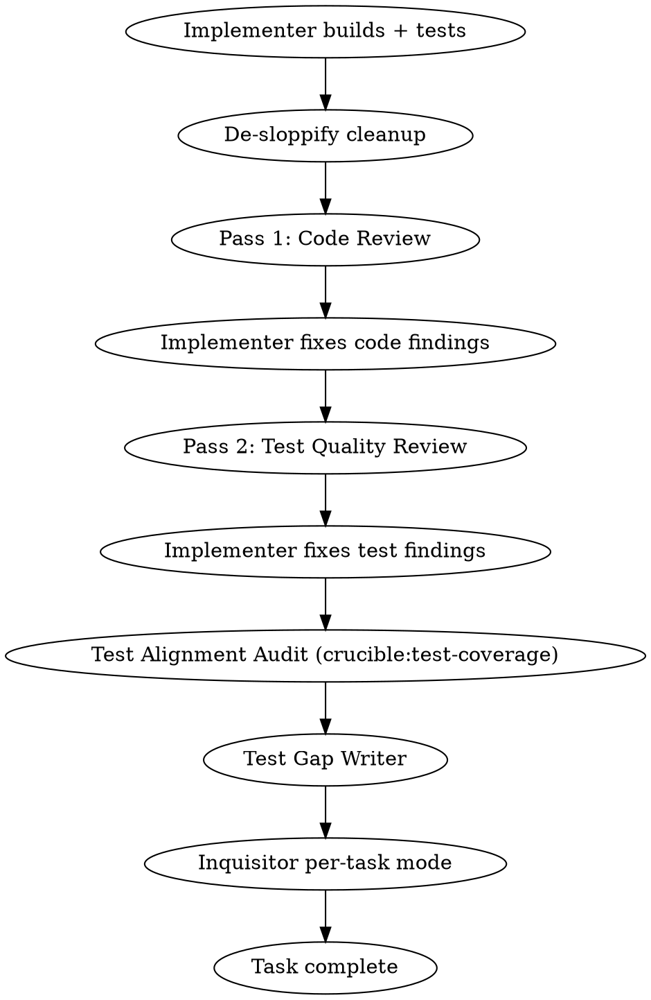

# Build — Phase 3: Execute

## Contents

- [Phase 3: Execute (Autonomous, Team-Based)](#phase-3-execute-autonomous-team-based)
  - [Step 0: Load Module Context for Subagents](#step-0-load-module-context-for-subagents)
  - [Step 0.5: Gate Ledger — Phase 3 Start](#step-05-gate-ledger--phase-3-start)
  - [Step 1: Create Team and Task List](#step-1-create-team-and-task-list)
  - [Step 2: Analyze Dependencies and Execution Order](#step-2-analyze-dependencies-and-execution-order)
  - [Step 3: Execute Tasks](#step-3-execute-tasks)
  - [Noticed Reconciliation](#noticed-reconciliation)
  - [Gate Ledger — Phase 3 Complete](#gate-ledger--phase-3-complete)
  - [Phase Handoff: 3 → 4](#phase-handoff-3--4)

## Phase 3: Execute (Autonomous, Team-Based)

> **Eval-gate pointer (Mock Dispatch Mode):** when `CRUCIBLE_BUILD_EVAL_MOCK_DIR` is set, all per-task dispatches in this phase (implementer, reviewer, cleanup, test-coverage, test-gap-writer, inquisitor per-task mode, architecture-reviewer) use the mock-dir substitution rule defined in the `## Mock Dispatch Mode (eval-gate)` section in `references/runtime-protocols.md`. TeamCreate and TaskCreate calls run normally — only the Task/Agent tool invocations on teammates are substituted.

### Step 0: Load Module Context for Subagents

- **RECOMMENDED SUB-SKILL:** Use crucible:cartographer-skill (load mode) — when dispatching implementers and reviewers, include relevant module files, conventions.md, and landmines.md in their dispatch files

- **Defect signature loading (for implementers only):**
  1. Glob `defect-signatures/*.md` (excluding `*.non-matches.md`) from the cartographer storage directory
  2. For each signature, read its `Modules` field and match against the task's target modules:
     - Read each cartographer module file's `Path:` field
     - A task's file is in a module if the file path starts with the module's `Path:` value
     - When a task spans multiple modules, load signatures for all matched modules
     - **Directory prefix fallback:** When no cartographer modules exist, match if any target file path starts with any of the signature's `Modules` directory prefixes
  3. For matching signatures, validate all file paths still exist on disk — drop stale entries silently
  4. Inject into the `[DEFECT_SIGNATURES]` section of `build-implementer-prompt.md`:
     - Generalized pattern (always)
     - Confirmed siblings list (always)
     - Unresolved siblings list (always — these are known live defects; produces a stronger warning)
     - Non-match companion files are NOT loaded for implementers
  5. **`Last loaded` update:** Loading is pure-read. After all implementer dispatches for the current phase complete, batch-update the `Last loaded` field to today on all signatures that were loaded. Do NOT update during dispatch — defer to after all subagents are dispatched.

- **Grudge pre-flight (regression-oracle, #271):** Before dispatching implementers, query the **Book of Grudges** for each task's in-scope files and inject any matches into that implementer's dispatch file as a hard **DO NOT REPEAT** constraint (sibling to defect-signature loading). Resolve the helper by absolute path from the plugin root — `plugin_root="$(realpath "<this-skill-base-dir>/../..")"` — and run `python3 "$plugin_root/scripts/grudge_query.py" <task files…>`; non-empty output lists past regressions held against those files. Best-effort: if the helper is unresolved, emit a one-line stderr warning and continue — a missing pre-flight must NEVER block the build. See `skills/grudge/SKILL.md`.

### Step 0.5: Gate Ledger — Phase 3 Start

**Write Phase 3 IN_PROGRESS** to the gate ledger (after Phase 2 PASS verification).

### Step 1: Create Team and Task List

Create a team using `TeamCreate`:
```
team_name: "build-<feature-name>"
description: "Building <feature description>"
```

Read the approved plan. Create tasks via `TaskCreate` for each plan task, including:
- Subject from plan task title
- Description with full plan task text (subagents should never read the plan file)
- Dependencies via `TaskUpdate` with `addBlockedBy`

#### Agent Teams Fallback

If `TeamCreate` fails (agent teams not available), output a clear one-time warning:

> ⚠️ Agent teams are not available. Recommended: set `CLAUDE_CODE_EXPERIMENTAL_AGENT_TEAMS=1`
> Falling back to sequential subagent dispatch via Agent tool.

Then fall back to sequential subagent dispatch via the regular Task tool (without `team_name`). Everything still works — independent tasks run sequentially instead of in parallel via teammates.

**What changes in fallback mode:**
- Tasks are dispatched via `Agent` tool instead of as teammates
- Independent tasks that would run in parallel now run sequentially
- Task tracking still uses `TaskCreate`/`TaskUpdate` for state management
- All other pipeline behavior (TDD, review, de-sloppify, quality gates) is unchanged

### Step 2: Analyze Dependencies and Execution Order

Before dispatching:
1. Map the dependency graph from plan task metadata
2. Identify independent tasks (no shared files, no sequential dependencies)
3. Group into execution waves — independent tasks parallel, dependent tasks sequential
4. Assess complexity per task for reviewer model selection

### Step 3: Execute Tasks

For each task (or wave of parallel tasks):

**RECOMMENDED SUB-SKILL:** Before dispatching each execution wave, use crucible:checkpoint — create checkpoint with reason "pre-wave-N" (where N is the wave number). This captures the working directory state after the prior wave's verification gate passed.

1. Mark task `in_progress` via `TaskUpdate`
2. Spawn **Implementer** teammate (Opus) via Task tool with `team_name` and `subagent_type="general-purpose"`
   - Use `./build-implementer-prompt.md` template
   - Pass full task text, file paths, project conventions
   - **Contract-aware dispatch (when a contract exists for this ticket):** Include the contract YAML alongside the design doc and task description. See "Contract-Aware Implementer Guidance" below.
   - Implementer follows TDD, writes tests, runs tests, commits, self-reviews
3. When Implementer reports completion, run **De-Sloppify Cleanup** (see below)
4. After cleanup completes, spawn **Reviewer** teammate
   - Use `./build-reviewer-prompt.md` template
5. **Tier-aware review routing:** Read the task's `Review-Tier` from plan metadata.
   - **Tier 1:** Dispatch single-pass code reviewer (Sonnet). If Clean or Minor-only: task complete. If Critical/Important: dispatch implementer fix, then task complete. If Architectural Concern: escalate.
   - **Tier 2:** Dispatch iterative code review (per existing loop). Then dispatch single-pass test reviewer. If test review surfaces Critical findings, escalate to Tier 3. Then dispatch Inquisitor per-task mode (per existing logic). Task complete.
   - **Tier 3:** Follow current full pipeline (no changes to existing flow).

#### Contract-Aware Implementer Guidance

When a contract YAML exists for the current ticket (detected during Step 0 or produced by `/spec`), the implementer receives the contract alongside the design doc and task description. The contract uses the schema defined in [`crucible:spec/contract-schema.md`](../../spec/contract-schema.md) (version `1.0`). Implementers must treat contract elements as follows:

1. **`api_surface` declarations are binding.** The implementer must match the declared function signatures, class interfaces, endpoint shapes, parameter names, types, and return types exactly. Deviations from the contract's API surface are implementation errors.

2. **`checkable` invariants are binding.** The implementer must satisfy all declared constraints (e.g., "must not import X", "must be idempotent"). The `check_method` field (`grep`, `code-inspection`, `file-structure`) indicates how the quality gate will verify compliance — the implementer should self-check against these before committing.

3. **`testable` invariants require tagged tests.** For each `testable` invariant, the implementer must write a test tagged with the declared `test_tag` (pattern: `contract:<category>:<id>`) that validates the invariant. These tests are checked by the quality gate and reviewers — they must exist and pass.

4. **`integration_points` are informational.** These indicate which other components and contracts this ticket interacts with. The implementer should be aware of referenced components and ensure compatibility, but integration points are not binding constraints — they provide context for making good implementation decisions.

#### De-Sloppify Cleanup

<!-- TRUST: subagent report is L4 — cross-check file paths and claims against L3 source before acting. -->
After the implementer reports completion and before dispatching the reviewer:

**RECOMMENDED:** Use crucible:checkpoint — create checkpoint with reason "pre-cleanup-task-N" before dispatching the cleanup agent. If cleanup removes something needed, restore to this checkpoint.

1. Record the pre-cleanup commit SHA
2. Dispatch a fresh **Cleanup Agent** (Opus) using `./cleanup-prompt.md`
   - Input: `git diff <pre-task-sha>..HEAD` (the implementer's committed changes)
   - The orchestrator provides the pre-task commit SHA to the cleanup agent
3. Cleanup agent reviews changes, removes unnecessary code (see allowlist), runs tests
4. If cleanup made changes, commits separately: `refactor: cleanup task N implementation`
5. If cleanup found nothing to remove, reports "No cleanup needed" and proceeds

#### Reviewer Model Selection (Lead Decides Per-Task)

| Task Complexity | Reviewer Model |
|----------------|----------------|
| Low (1-3 files, straightforward) | Sonnet |
| Medium (3-6 files, some cross-system) | Lead decides (default Opus) |
| High (6+ files, refactoring, deep chains) | Opus |
| When in doubt | Opus |

#### Two-Pass Review Cycle

Each task gets TWO review passes before completion:



**Pass 1 — Code Review:** Architecture, patterns, correctness, wiring (actually connected, not just existing?)

**Pass 2 — Test Quality Review:** Test independence? Determinism? Edge cases? Integration tests where mocks are masking real behavior? AAA pattern? Correct test level? (Staleness and alignment checks are handled by the test-coverage dispatch below.)

#### Review Tier Routing

Each task's `Review-Tier` (from the plan) determines which review steps execute. Phase 4 full-implementation gates are NOT affected by per-task tiers.

| Step | Tier 1 | Tier 2 | Tier 3 |
|------|--------|--------|--------|
| Implementer | Yes | Yes | Yes |
| De-sloppify cleanup | Yes | Yes | Yes |
| Pass 1: Code review | Single pass | Iterative | Iterative |
| Implementer fixes (code) | If findings | If findings | If findings |
| Pass 2: Test quality review | SKIP | Single pass (non-iterative) | Iterative |
| Implementer fixes (test) | SKIP | If critical findings only | If findings |
| Test alignment audit | SKIP | SKIP | Yes |
| Test gap writer | SKIP | SKIP | Yes |
| Inquisitor per-task mode | SKIP | Yes | Yes |

**Tier 1 "single pass" code review:** Dispatch one reviewer. If findings are Clean, task is complete. If findings include Critical or Important issues, dispatch implementer to fix, then the task is complete (no re-review). If findings include an Architectural Concern, escalate as normal.

**Tier 2 "single pass" test review:** Dispatch one test quality reviewer. Report findings but do NOT enter the iterative review loop. If the single pass surfaces Critical findings, escalate the task to Tier 3 for full iterative treatment.

**Tier 2 "iterative" code review:** Same as current behavior -- fresh reviewer each round, track issue count, loop until clean or stagnation.

#### Runtime Tier Escalation

The orchestrator may escalate a task's review tier during execution. Escalation is one-directional (up only).

**Triggers:**
- Implementer reports unexpected complexity or cross-system interaction not anticipated in the plan
- Single-pass reviewer (Tier 1 code review or Tier 2 test review) reports Critical findings
- Implementer touches significantly more files than the plan specified

**Process:**
1. Log escalation to decision journal: `[timestamp] DECISION: review-tier | choice=escalate T1->T2 | reason=<trigger> | alternatives=none`
2. Execute the additional review steps for the new tier (from the point where the current tier's pipeline diverges)
3. Update the task status display to show the escalated tier

#### Contract-Aware Reviewer Guidance

When a contract YAML exists for the current ticket, reviewers receive the contract alongside the implementation and must add the following checks to both review passes:

1. **API surface compliance:** Do the implemented public interfaces match the `api_surface` declarations in the contract? Check function signatures, class interfaces, endpoint shapes, parameter names/types, and return types. Any deviation from the contract's declared API surface is a blocking finding.

2. **Checkable invariant satisfaction:** Are all `checkable` invariants satisfied per their declared `check_method`?
   - `grep`: verify the pattern match (or absence) in production code
   - `code-inspection`: read and reason about code to confirm the invariant holds
   - `file-structure`: check file existence/organization matches the constraint
   Any unsatisfied checkable invariant is a blocking finding.

3. **Testable invariant test existence:** Does a test exist for each `testable` invariant, tagged with the correct `test_tag` (pattern: `contract:<category>:<id>`)? A missing tagged test is a blocking finding.

4. **Test correctness:** Do the tagged tests actually validate the invariant they claim to cover? A test that exists but does not meaningfully exercise the invariant (e.g., a trivially passing assertion, a test that tests something unrelated despite having the right tag) is a blocking finding.

**Severity:** All contract-related review findings are classified as **blocking** — the same severity as contract violations in the quality gate. Contract findings must be resolved before the task is marked complete.

#### Test Alignment Audit

After the implementer addresses Pass 2 findings, invoke `crucible:test-coverage` against the task's changes:
- Code diff: `git diff <pre-task-sha>..HEAD`
- Affected test files: test files touched or related to the task
- Context: "Build task N: [task description]"

The test-coverage skill audits existing tests for staleness (wrong assertions, misleading descriptions, dead tests, coincidence tests) and handles its own fix dispatch and revert-on-failure logic. It returns a structured report. Note: the diff includes review fix commits — the audit agent should focus on behavioral changes to source files, not changes that only touch test files.

**Skip this step if** the task made no behavioral source changes (only `.md`, `.json`, config files).

#### Test Gap Writer

After test-coverage completes (or is skipped), dispatch a **Test Gap Writer** (Opus) using `./test-gap-writer-prompt.md`:

1. Input: Pass 2 test reviewer's missing coverage findings + implementer's changes + test-coverage audit report (if available)
2. The test gap writer writes tests ONLY for gaps the reviewer identified — no scope creep. Before writing a new test for a flagged gap, verify no existing test already covers this path (it may have been updated by the test-coverage audit).
3. Tests should pass immediately (the behavior already exists from implementation)
4. The test gap writer reports per-test PASS/FAIL results (see prompt template for report format)
5. Commits new tests: `test: fill coverage gaps for task N`

**If all tests PASS:** Continue to Inquisitor per-task mode.

**If some tests FAIL** (gaps reveal genuinely missing implementation):
1. Dispatch a fresh implementer (Opus) with the failing test(s), their failure messages, and the gap descriptions from the reviewer
2. Implementer fixes the missing behavior, then re-runs ALL test gap writer tests (not just the failures — catches regressions from the fix)
3. If all tests pass after fix: commit (`fix: address test gap failures for task N`), continue to Inquisitor per-task mode
4. If tests still fail after one fix attempt: **escalate to user** with:
   - Which coverage gaps the reviewer identified
   - Which tests the gap writer wrote (per-test PASS/FAIL)
   - What the implementer attempted to fix
   - Which tests still fail and their current failure messages

**Skip this step if** the Pass 2 test reviewer reported zero missing coverage gaps.

#### Inquisitor Per-Task Mode

After the test gap writer completes (or is skipped), dispatch **Inquisitor per-task mode** (Opus) using `skills/inquisitor/break-it-prompt.md`:

1. Input: Full diff of the task's changes (`git diff <pre-task-sha>..HEAD`), project test conventions, cartographer module context (if available)
2. Inquisitor per-task mode ranks failure modes by likelihood and impact, then writes and runs up to 5 tests (fewer when fewer candidates are meaningful).
3. Outcome handling:
   - **All tests PASS:** Implementation is robust. Log results and proceed to task complete.
   - **Some tests FAIL:** Real weaknesses found. Dispatch implementer to fix. Re-run all tests (including adversarial). If pass → task complete. If fail → one more fix attempt, then escalate to user.
   - **Tests ERROR (won't compile):** Inquisitor per-task mode mistake. Discard broken tests, log, proceed to task complete.
4. Quality bypass prevention: If the implementer's fix touches more than 3 files, route through a lightweight code review before completing.
5. Commit adversarial tests: `test: adversarial tests for task N`

**Skip this step when:**
- The task diff contains no behavioral source files (only `.md`, `.json`, `.yaml`, `.uss`, `.uxml`)
- No tests were written during implementation (pure scaffolding)

#### Iterative Review Loop

Each review pass (code and test) uses the iterative loop:
- After fixes, dispatch a **NEW fresh Reviewer** (no anchoring to prior findings)
- Track issue count between rounds
- **Strictly fewer issues** → progress, loop again
- **Same or more issues** → stagnation, **escalate to user**
- Loop until clean
- Architectural concerns → **immediate escalation** regardless of round

#### Verification Gates

After each wave completes:
1. Run full test suite (not just current wave's tests)
2. Check compilation
3. Failures → identify which task caused regression before fixing
4. Clean → proceed to next wave

#### Refactor Mode: Phase 3 Changes

When in refactor mode, Phase 3 execution differs from feature mode in several ways.

##### Pre-Execution Coverage Check

Before the first task executes:
1. Run all contract tests from Phase 1 — confirm GREEN
2. Run the full test suite — confirm GREEN (pre-execution baseline)
3. Record the "baseline commit" SHA in `<build-scratch>/build-mode.md` — this is the rollback target

##### Tiered Test Strategy

Running the full test suite after every atomic step is prohibitively expensive. Instead:

- **(a) After each atomic task:** Run blast-radius tests + direct consumer tests only (tests identified in the impact manifest)
- **(b) After each execution wave:** Run the full test suite (matches existing verification gate between waves)
- **(c) Full suite checkpoints:** Pre-execution baseline and Phase 4 final verification always run the full suite

##### Coordinated-Atomic Execution

When the executor encounters a task marked `atomic: true`:

1. Record pre-task commit SHA
2. Implementer makes ALL changes (multiple files) — dispatch with `./refactor-implementer-addendum.md` appended
3. Run blast-radius tests + direct consumer tests (per tiered strategy)
4. **If GREEN:** Commit all files together in a single commit
5. **If FAIL:** Revert ALL files to pre-task SHA. Dispatch one retry with a fresh implementer that receives the failure context and test output. If second attempt also fails, revert to pre-task SHA and escalate to user (see Rollback Policy below).

**Key difference from feature mode:** Feature mode does RED-GREEN-REFACTOR. Refactor mode for atomic steps does **GREEN-GREEN** — tests are green before, tests must be green after. No RED phase because no new behavior is being added.

After a successful atomic commit (step 4), the rest of the per-task pipeline continues as normal: de-sloppify cleanup, two-pass review cycle, test alignment audit, test gap writer, and Inquisitor per-task mode (unless skipped per restructuring-only annotation below).

**Non-atomic refactoring tasks** follow normal execution — structural changes that don't break intermediate states (e.g., extracting a private method, adding a module nothing imports yet). These use standard TDD if they introduce new abstractions, or GREEN-GREEN if they are pure restructuring.

##### Phase 3 Adaptations for Existing Steps

- **Inquisitor per-task mode:** The planner annotates each task with `restructuring-only: true/false`. If `restructuring-only: true`, per-task adversarial testing is skipped. Tasks with `restructuring-only: false` still get it. When in doubt, default to `false`.
  - `restructuring-only: true` examples: renames where all call sites are mechanically updated, file moves with updated paths, extract-method where the extracted method is private and preserves the original call signature
  - `restructuring-only: false` examples: extract-class where callers must change call targets, splitting a module where consumers must update imports, any change where the consumer-facing API surface shifts
- **De-sloppify cleanup:** Gains a new removal category: **dead compatibility shims.** After a refactoring task, look for leftover adapter code, re-export aliases, or compatibility layers introduced during migration but no longer referenced. Detection scope: code added after the baseline commit SHA that re-exports, aliases, or wraps symbols under old names, AND where no code outside the refactoring's changed files references the old names. **String-based references:** When the target was registered by name in a configuration system, flag the shim as UNCERTAIN and defer to the reviewer rather than removing it.

##### Refactoring Rollback Policy

###### Baseline Commit
The orchestrator records the baseline commit SHA before the first refactoring task executes (during pre-execution coverage check). Persisted in `<build-scratch>/build-mode.md`.

###### Per-Task Rollback
When a single task fails after the executor's retry attempt:
1. Revert that task's changes to the pre-task commit SHA
2. Escalate to user with failure context and test output
3. User chooses: **skip this task and continue** (orchestrator also skips all tasks that depend on the skipped task, and informs the user which tasks were transitively skipped), **retry with guidance**, or **revert all tasks to baseline**

###### Full Rollback to Baseline
When the user chooses full rollback (or cascading failures make forward progress impossible):
1. Perform `git reset --hard <baseline-SHA>` to restore pre-refactoring state
2. Re-run all contract tests to confirm known-good state
3. Report what was reverted and why

###### Safe Partial States
The planner annotates tasks with `safe-partial: true/false`. A task is `safe-partial: true` if the codebase is in a valid, shippable state after that task completes (all tests green, no dangling references). When a later task fails, the orchestrator can offer to keep changes through the last safe-partial task.

#### Architectural Checkpoint

For plans with 10+ tasks, at ~50% completion or after a major subsystem:
- Dispatch architecture reviewer using `./architecture-reviewer-prompt.md`
- Design drift → escalate to user
- Minor concerns → adjust prompts for remaining tasks
- All clear → continue

### Noticed Reconciliation

After all implementers in Phase 3 report back and before writing the Phase 3 COMPLETE ledger entry, aggregate their `### Noticed But Not Touching` sections into a single `docs/plans/<YYYY-MM-DD>-<ticket-slug>-noticed.md` artifact.

**Scope discipline:** Notice, do not act. If an implementer sees an out-of-scope issue during implementation, it must be logged under `### Noticed But Not Touching` in their report — NOT fixed in their diff. Acting on noticed items in the same task is a scope-discipline failure. The orchestrator enforces this via reconciliation: noticed entries are surfaced here and converted to follow-up tickets later (see `/finish`).

**7-step reconciliation process:**

1. Collect each implementer's `### Noticed But Not Touching` section from every Phase 3 implementer report.
2. Skip any section whose body is `*(none)*`.
3. Dedupe entries using the canonical dedupe key: `sha256( normalize(file_path) + "|" + line_range + "|" + noticed[:40] )`, where `normalize(file_path)` is the repo-relative POSIX path lowercased.
4. Sort the deduped entries by file path, then line range.
5. If any entries remain, write `docs/plans/<YYYY-MM-DD>-<ticket-slug>-noticed.md` matching the canonical filename regex `^docs/plans/\d{4}-\d{2}-\d{2}-[a-z0-9-]+-noticed\.md$`. Use the date embedded in the sibling plan filename (not wall-clock date) so all sibling artifacts share a date; slug matches the ticket being built. Frontmatter and body must follow the Canonical Constants template exactly:

   ```markdown
   ---
   pipeline_id: "<build-YYYYMMDD-HHMMSS>"
   date: "YYYY-MM-DD"
   ticket: "#NNN"
   ---

   # Noticed But Not Touching — <ticket-slug>

   - **file:** `path:L<start>-L<end>`
     **noticed:** <desc>
     **why it matters:** <risk/opportunity>
     **suggested follow-up:** <optional>
   ```

6. **Idempotent overwrite:** If the target `-noticed.md` already exists (same-ticket re-run on the same date), merge the existing entries with the newly collected entries, run the full dedupe (same key), sort, and overwrite the file in one write. No append-mode; the on-disk file is always the full deduped set for that date+ticket.
7. Stage the `-noticed.md` file so it lands in the PR commit.

Skip the write entirely if zero entries remain after dedupe — do not produce an empty `-noticed.md`.

### Gate Ledger — Phase 3 Complete

After the last task wave's verification gate passes and all tasks are marked complete — but BEFORE the Phase 3→4 handoff — write `Status: COMPLETE` and `Tasks: N/N complete` to the Phase 3 ledger entry. If any task is in a retry/re-dispatch loop, COMPLETE is NOT written until retries resolve.

### Phase Handoff: 3 → 4

Before running acceptance tests and code review, verify the gate ledger and write a handoff manifest:

0. **Gate ledger check:** Read `<build-scratch>/build-gate-ledger.md` and verify Phase 3 Status is `COMPLETE`. If not, follow Enforcement Rules.

Write the handoff manifest:

1. Write `<build-scratch>/handoff-3-to-4.md` with:
   - **Goal:** original user request, verbatim
   - **Mode:** feature or refactor
   - **Inputs for Phase 4:** HEAD SHA (all tasks committed), design doc path, acceptance test paths (or contract tests), baseline SHA (for `git diff` scope), task summary (completed count, escalation outcomes)
   - **Decisions Carried Forward:** accumulated decisions from Phases 1-3
   - **Active Constraints:** constraints affecting completion review
   - **Shed Receipt:** per-task review rounds, implementer context, wave verification details → task completion status in task list; per-task review details are shed
2. Emit shed statement: "Phase 3 context shed. Working code at HEAD, design doc, and acceptance tests on disk. Per-task implementation context, review rounds, and verification details are not carried forward."
3. Update `## Compression State` in `<build-scratch>/pipeline-status.md` with manifest contents.
4. Do NOT emit a Compression State Block.
5. **Session index event:** Emit a `phase_change` event to the outbox: `{"ts":"<now>","seq":0,"type":"phase_change","summary":"Build: Phase 3 -> Phase 4 (Completion)","detail":{"skill":"build","from":"3","to":"4"}}`.
